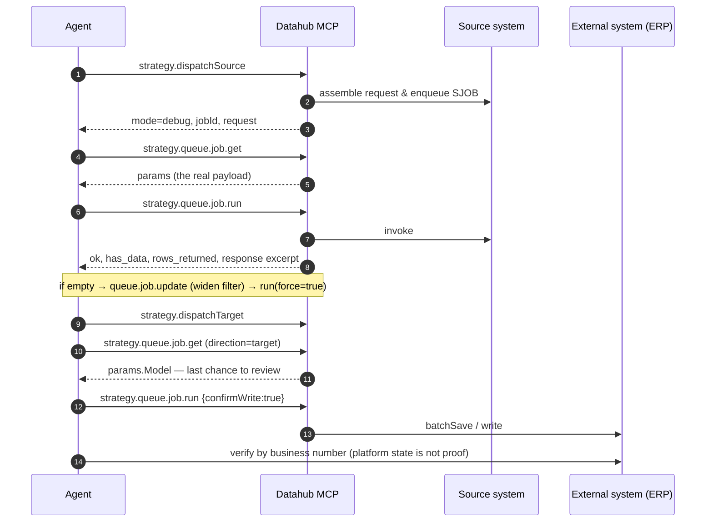

<div align="center">


# Datahub MCP Ops Skill

**An executable playbook that teaches AI agents to actually operate Datahub (轻易云) through MCP.**

Debug jobs without a daemon · repair field mappings · verify writes · diagnose failures · clean up safely

[](https://github.com/qeasy-cloud/datahub-mcp-ops/actions/workflows/validate.yml)
[](CHANGELOG.md)
[](LICENSE)
[](tools/manifest.json)
[](scripts/dh.py)
[](docs/clients.md)

**English** · [简体中文](README.zh-CN.md)

</div>

---

## Why this exists

Most MCP documentation tells an agent **which tools exist**. Real integration work needs something else:

- **Order** — should I call `dbInfo` first or `get`? Why must I *not* `start` the strategy?
- **Judgement** — `ok=true` but `has_data=false`: is that success or silence?
- **Boundaries** — when must the agent stop and ask a human?
- **Next step after failure** — `"格式错误，不能转换为字典类型"` — what exactly do I change?

This repository answers those questions as **"symptom → evidence → action"**, backed by real MCP transcript fragments.
It is written for agents first (progressive disclosure) and remains readable for humans.

| Pain in the real world | What this skill does |
|---|---|
| Test tenant has **no daemon**: nothing consumes the queue | Six-step debug loop: dispatch → read job → consume → patch params → re-run |
| Platform says "success", business sees no data | `ok` and `has_data` are separated; an empty response is not success |
| Target fields "are all filled in" yet the payload is empty | Bare field names are constants — only `{{SourceField}}` reads data |
| Every error tempts you to edit metadata | Patch **job params** first, prove the hypothesis, write back later |
| Cleanup is scary | `dryRun` preview + blast-radius circuit breaker + one-shot confirmation token |
| Unclear whether platform state is proof | It is not — verify against the external system |

---

## What you get

| | |
|---|---|
| **8 references** | Platform mechanics, all 46 tools, debug loop, write recipe, diagnostics, knowledge MCP, security, anti-patterns |
| **4 playbooks** | Source-side bring-up · target-side real write · requirement-to-production · batch ops & cleanup |
| **2 worked examples** | Copy-paste prompts · a real (redacted) debug session with actual responses |
| **Zero-dependency CLI** | `scripts/dh.py` — `doctor` / `tools` / `call` / `manifest` / `raw`, Python 3.9+ stdlib only |
| **Quality gates** | Offline validator, live read-only smoke test, and a manifest generated from the server itself |
| **46 tools covered** | Including the seven that make daemon-free debugging possible |

---

## Quick start

### 1 · As a CLI (fastest)

```bash
git clone git@github.com:qeasy-cloud/datahub-mcp-ops.git
cd datahub-mcp-ops

export DH_MCP_URL="https://<your-host>/api/mcp"
export DH_MCP_KEY="sh-..."          # tenant key from the platform console

python scripts/dh.py doctor         # endpoint · key · protocol · tool count
python scripts/dh.py tools          # 46 tools, grouped by domain
python scripts/dh.py call meta.whoami
python scripts/dh.py call strategy.dbInfo --param strategyId=<STRATEGY_ID>
```

> `--param` avoids shell quoting problems on Windows; `--args @args.json` handles nested payloads.
> Python 3.9+ with no third-party packages. Legacy env names (`DATAHUB_MCP_URL` / `DATAHUB_MCP_TOKEN`) still work.

### 2 · As an MCP server in your client

```jsonc
{
  "mcpServers": {
    "datahub": {
      "type": "http",
      "url": "https://<your-host>/api/mcp",
      "headers": { "Authorization": "Bearer ${DH_MCP_KEY}" }
    }
  }
}
```

Ready-made snippets for Claude Code/Desktop, Cursor, VS Code and Cline: [`tools/mcp-config.example.json`](tools/mcp-config.example.json) · details in [`docs/clients.md`](docs/clients.md).

### 3 · As an agent skill

Copy this directory into your agent's skills path and point the agent at [`SKILL.md`](SKILL.md).

| Runtime | Install location |
|---|---|
| DeepSeek Harness | `.agents/skills/datahub-mcp-ops/` (auto-discovered, hot-reloaded) |
| Claude Code | `~/.claude/skills/datahub-mcp-ops/` or project `.claude/skills/` |
| Cursor / VS Code / Cline | No skill install needed — register the MCP server; add `SKILL.md` to project rules if desired |
| Codex / custom agents | Reference `SKILL.md` from `AGENTS.md` and register the MCP server |

The agent reads `SKILL.md` (≈9.7k characters) first, then opens exactly one reference on demand.

---

## The 60-second mental model

```
tenant
 ├─ platform     (adapter definition: Kingdee Cloud, Wangdian, …)
 ├─ connector    (an instance of a platform: host / data center / account / secret)
 ├─ api asset    (endpoint catalogue: query & write capabilities)
 └─ strategy     ← almost everything you touch
     ├─ source   : connector + api + meta_data (query params + response fields)
     ├─ target   : connector + api + meta_data (write params + field mapping)
     └─ schedule : crontab for each side

runtime chain
  cron → fetch → data records → source queue → target queue → external write → logs
                              ↘ exceptions (the only place "errors" really live)
```

Three identifiers: `strategyId` (UUID), `jobId` (24-hex), `dataId` (ObjectId).
Three states that are **not** interchangeable: strategy `status`, `is_online`, and data/queue `status`.

Full mechanics — metadata layers, `{{}}` evaluation, parsers, pagination, idempotency, event scripts — are distilled into
[`references/01-platform-model.md`](references/01-platform-model.md) so agents do **not** need a knowledge lookup for the basics.

---

## The debug loop (the reason this repo exists)



- `ok=true, has_data=false` means **executed but nothing fetched** — the platform treats an empty response as "finished".
- `direction=target` always requires `confirmWrite=true`; trust level cannot bypass an external side effect.
- Finished jobs are not re-executed unless `force=true` (idempotency guard).

Step-by-step: [`playbooks/p1-debug-source.md`](playbooks/p1-debug-source.md) → [`playbooks/p2-debug-target-write.md`](playbooks/p2-debug-target-write.md) · mechanics: [`references/03-debug-loop.md`](references/03-debug-loop.md)

---

## Tool coverage (46 = 43 business + 3 meta)

| Domain | Tools |
|---|---|
| **meta** (3) | `whoami` `capabilities` `enums` |
| **asset** (6) | `platform.list/get` `connector.list/get` `api.list/get` |
| **strategy read** (8) | `list` `get` `showConfig` `dbInfo` `queue.list` `queue.job.get` `log.search` `data.search` |
| **strategy debug** (5) | `dispatchSource` `dispatchTarget` `queue.job.run` `queue.job.update` `exception.search` |
| **strategy write** (6) | `create` `copy` `update` `source.update` `target.update` `config.rollback` |
| **lifecycle** (5) | `start` `stop` `online` `offline` `checkList` |
| **data & cleanup** (6) | `data.import` `data.setStatus` `dbResetStatus` `data.clean` `queue.clean` `data.cleanAll` |
| **script** (6) | `list` `get` `validate` `create` `write` `delete` |
| **audit** (1) | `search` |

Five of them are **irreversible** (`data.clean`, `queue.clean`, `data.cleanAll`, `script.delete`, `data.setStatus`).
Full contracts, arguments, return shapes and gotchas: [`references/02-tool-catalog.md`](references/02-tool-catalog.md).
Machine-readable snapshot: [`tools/manifest.json`](tools/manifest.json).

---

## Platform knowledge built in

Agents burn their knowledge quota asking "how does this platform work". This repo ships a distilled, source-attributed
mechanism guide instead — [`references/01-platform-model.md`](references/01-platform-model.md):

metadata three-layer model · `type` vs `effect` dual semantics · `otherResponse` positional slots · `idCheck` ·
value evaluation (`{{key|format|default}}`, system variables, 7 parsers) · three `operation` strategies ·
runtime chain & storage collections · pagination & incremental watermarks · idempotency & self-loop ·
14 event hooks of which **only 5 actually fire** · metadata reuse (capability = endpoint × field set × filter × mapping × script).

It explicitly ends with *what it does not cover* — object field lists, customer cases, and cross-platform semantics still
belong to the public knowledge MCP. That split is documented in [`references/06-knowledge-mcp.md`](references/06-knowledge-mcp.md),
including the verified stateless endpoint, the proof-of-work registration flow and citation discipline.

---

## Compatibility

| Ecosystem | Status | How |
|---|---|---|
| **DeepSeek Harness** | ✅ verified in production use | auto-discovered under `.agents/skills/`, hot-reloaded |
| **Claude Code / Desktop** | ✅ by design | Agent Skills frontmatter + progressive disclosure |
| **Cursor · VS Code · Cline · Continue · opencode** | ✅ at the MCP layer | Streamable HTTP + Bearer; skill optional |
| **OpenAI Codex CLI** | ⚠️ partial | `AGENTS.md` pointer + `[mcp_servers]` in `config.toml` (no native skill discovery) |
| Other agent runtimes | testable in 5 minutes | see [`docs/clients.md`](docs/clients.md) §1 |

Degrade gracefully: Markdown alone is a usable runbook; add Python for automation; add MCP for native tool discovery.

---

## Quality gates (docs as tests)

```bash
python scripts/validate_skill.py -v   # offline: structure, frontmatter, manifest↔docs consistency, links, secrets
python scripts/dh.py manifest > tools/manifest.json   # refresh after a server upgrade
DH_MCP_URL=… DH_MCP_KEY=… python scripts/smoke_test.py --expect-tools 46   # live, read-only
```

- `tools/manifest.json` is **generated from the server**, not hand-written; CI fails if a documented tool does not exist.
- CI also compiles every script, validates the manifest against its JSON Schema, and (non-blocking) lints Markdown.
- Nothing in CI needs a live tenant: the suite is deterministic and offline.

---

## Repository layout

```
SKILL.md                    agent entry point (progressive disclosure, ~250 lines)
references/                 8 deep dives: mechanics · tools · debug · write · diagnostics · knowledge · security · anti-patterns
playbooks/                  4 runnable scenarios
examples/                   prompts + a real debug transcript
scripts/                    dh.py (CLI) · validate_skill.py (offline) · smoke_test.py (live)
tools/                      manifest.json (generated) · schema · client config
templates/                  blueprint · report · field-mapping sample · 46-tool acceptance matrix
docs/                       architecture · clients · FAQ · releasing · assets
.github/                    CI · issue & PR templates · CODEOWNERS
```

Documentation map and reading paths: [`SKILL.md`](SKILL.md) §9.

---

## Roadmap

- [x] v2.0.0 — daemon-free debug loop, 7 new tools, blast-radius circuit breaker, platform mechanics digest
- [ ] v2.1 — 46-tool acceptance matrix run as a release gate; target-side live verification recipe
- [ ] v2.2 — error catalogue expansion per platform (Kingdee → Wangdian/Purchase-Cloud)
- [ ] v3.0 — scenario library (multi-strategy orchestration, reconciliation patterns)

See [`CHANGELOG.md`](CHANGELOG.md) for what shipped and why.

---

## FAQ & contributing

- **FAQ** — [`docs/faq.md`](docs/faq.md): keys, quota, `sections=basic`, "success but no data", two different MCP endpoints…
- **Contributing** — [`CONTRIBUTING.md`](CONTRIBUTING.md): the most valuable PR is a new *symptom → evidence → action* entry, or a redacted transcript.
- **Security** — [`SECURITY.md`](SECURITY.md): never open a public issue for a vulnerability; never commit a key.
- **Code of Conduct** — [`CODE_OF_CONDUCT.md`](CODE_OF_CONDUCT.md).

---

## License & commercial support

[MIT](LICENSE) — use it, fork it, ship it.

This skill is and will remain **open source**. It documents the MCP surface of the Datahub / 轻易云 integration platform;
the platform itself is a commercial product.

- Product & documentation: **https://www.qeasy.cloud**
- Public knowledge MCP (read-only, agent-registrable): **https://www.qeasy.cloud/mcp**
- Hosted platform trials and integration delivery: see the website

If this repository saved you an afternoon, a ⭐ helps other agents and integrators find it.

<div align="center"><sub>Built and maintained by <a href="https://www.qeasy.cloud">qeasy.cloud</a> and contributors.</sub></div>
