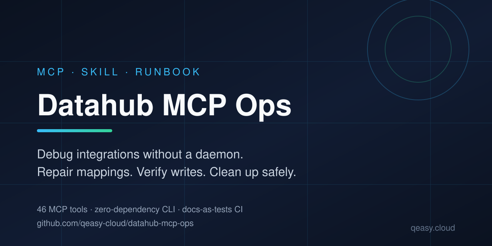
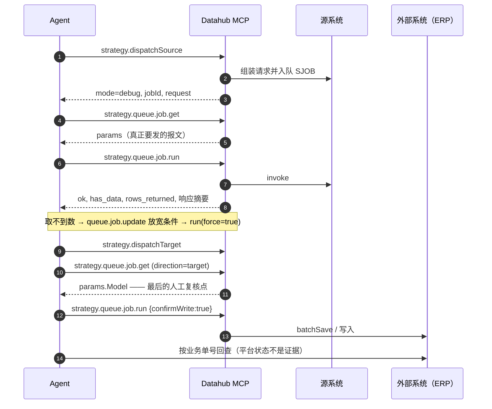

<div align="center">



# Datahub MCP Ops Skill

**让 AI Agent 真正会用轻易云（Datahub）MCP 的可执行手册。**

无守护进程调试 · 修复字段映射 · 验证写入 · 定位故障 · 安全清理

[](https://github.com/qeasy-cloud/datahub-mcp-ops/actions/workflows/validate.yml)
[](CHANGELOG.md)
[](LICENSE)
[](tools/manifest.json)
[](scripts/dh.py)

[English](README.md) · **简体中文**

</div>

---

## 为什么需要它

大多数 MCP 文档只告诉 Agent「有哪些工具」。真实集成工作需要的是另外四样东西：

- **顺序**：先 `dbInfo` 还是先 `get`？为什么**不能**先 `start`？
- **判读**：`ok=true` 但 `has_data=false`，这是成功还是"什么都没取到"？
- **边界**：什么时候必须停下来问人？
- **失败后的下一步**：报「格式错误，不能转换为字典类型」，到底改哪里？

本仓库把这些写成 **「症状 → 判据 → 处置」**，并用真实 MCP 会话片段做证据。
面向 Agent 优先（渐进披露），人类也读得懂。

| 真实痛点 | 本 SKILL 的答案 |
|---|---|
| 测试租户**没有守护进程**，队列没人消费 | 六步调试闭环：dispatch → 读任务 → 手工消费 → 改参数 → 重跑 |
| 平台说成功，业务没数据 | `ok` 与 `has_data` 分开看；空响应不是成功 |
| 目标端「字段都填了」但写出去是空 | 裸字段名是常量，只有 `{{源字段}}` 才取值 |
| 一报错就想改元数据 | 先改**任务参数**验证假设，调通再回写 |
| 清理怕删错 | `dryRun` 预演 + 影响面熔断 + 一次性令牌 |
| 不确定平台状态算不算证据 | 不算，必须回查外部系统 |

---

## 包含什么

| | |
|---|---|
| **8 篇 references** | 平台机制、58 个工具、调试闭环、写入配方、诊断字典、知识 MCP、安全边界、反模式 |
| **4 个 playbooks** | 源侧跑通 · 目标端真实写入 · 从需求到上线 · 批量运维与收尾 |
| **2 个实例** | 可直接复制的提示词 · 一次真实（脱敏）调试会话 |
| **零依赖 CLI** | `scripts/dh.py`：`doctor`/`tools`/`call`/`manifest`/`raw`，仅需 Python 3.9+ 标准库 |
| **质量门禁** | 离线校验器、在线只读冒烟、由服务端生成的工具清单 |
| **覆盖 58 个工具** | 含让"无守护进程调试"成为可能的 7 个新工具 |

---

## 快速开始

### 1 · 当作 CLI 用（最快）

```bash
git clone git@github.com:qeasy-cloud/datahub-mcp-ops.git
cd datahub-mcp-ops

export DH_MCP_URL="https://<你的域名>/api/mcp"
export DH_MCP_KEY="sh-..."          # 平台开放中心签发的租户密钥

python scripts/dh.py doctor         # 端点 · 密钥 · 协议 · 工具数
python scripts/dh.py tools          # 58 个工具，按域分组
python scripts/dh.py call meta.whoami
python scripts/dh.py call strategy.dbInfo --param strategyId=<方案ID>
```

> Windows 下推荐 `--param`（避免 shell 吞引号），复杂结构用 `--args @args.json`。
> 兼容 v1.x 环境变量名（`DATAHUB_MCP_URL` / `DATAHUB_MCP_TOKEN`）。

### 2 · 接进 MCP 客户端

```jsonc
{
  "mcpServers": {
    "datahub": {
      "type": "http",
      "url": "https://<你的域名>/api/mcp",
      "headers": { "Authorization": "Bearer ${DH_MCP_KEY}" }
    }
  }
}
```

Claude Code/Desktop、Cursor、VS Code、Cline 的现成片段见 [`tools/mcp-config.example.json`](tools/mcp-config.example.json)，
细节见 [`docs/clients.md`](docs/clients.md)。

### 3 · 当作 Agent Skill

把本目录复制到目标 Agent 的 skills 路径，并让 Agent 从 [`SKILL.md`](SKILL.md) 开始读。

| 运行时 | 安装位置 |
|---|---|
| DeepSeek Harness | `.agents/skills/datahub-mcp-ops/`（自动发现，改完热更新） |
| Claude Code | `~/.claude/skills/datahub-mcp-ops/` 或项目内 `.claude/skills/` |
| Cursor / VS Code / Cline | 无需装技能：注册 MCP server 即可；也可把 `SKILL.md` 放进项目规则 |
| Codex / 自研 Agent | 在 `AGENTS.md` 指向 `SKILL.md`，并注册 MCP server |

Agent 先读 `SKILL.md`（约 9.7k 字符），再按需只打开**一篇** reference。

---

## 60 秒心智模型

```
租户
 ├─ 平台 platform     （适配器定义：金蝶云星空、旺店通…）
 ├─ 连接器 connector  （平台实例：host / 数据中心 / 账号 / 密钥）
 ├─ 接口资产 api      （端点目录：查询与写入能力）
 └─ 方案 strategy     ← 你 90% 的操作对象
     ├─ 源端 source   ：连接器 + 接口 + meta_data（取数参数 + 响应字段）
     ├─ 目标端 target ：连接器 + 接口 + meta_data（写入参数 + 字段映射）
     └─ 调度          ：两侧各一个 crontab

运行链
  调度 → 取数 → 数据条目 → 源队列 → 目标队列 → 外部写入 → 日志
                          ↘ 异常队列（真正的"错误"只在这里）
```

三个 ID：`strategyId`（UUID）、`jobId`（24 位十六进制）、`dataId`（ObjectId）。
三个**不可混用**的状态：方案 `status`、`is_online`、数据/队列 `status`。

完整机制（元数据三层、`{{}}` 求值、parser、分页、幂等、事件脚本）已蒸馏进
[`references/01-platform-model.md`](references/01-platform-model.md)，基础问题**不必**再查知识 MCP。

---

## 调试闭环（本仓库存在的理由）



- `ok=true, has_data=false` = **执行成功但没取到数**（平台把空响应当"完成"）。
- `direction=target` 必须 `confirmWrite=true`；信任级别**不能**豁免外部副作用。
- 已结束的任务默认不重跑，需要 `force=true`（幂等保护）。

分步剧本：[`playbooks/p1-debug-source.md`](playbooks/p1-debug-source.md) → [`playbooks/p2-debug-target-write.md`](playbooks/p2-debug-target-write.md)

---

## 工具覆盖（58 = 55 业务 + 3 meta）

| 域 | 工具 |
|---|---|
| **meta**（3） | `whoami` `capabilities` `enums` |
| **asset**（6） | `platform.list/get` `connector.list/get` `api.list/get` |
| **strategy 读**（8） | `list` `get` `showConfig` `dbInfo` `queue.list` `queue.job.get` `log.search` `data.search` |
| **strategy 调试**（5） | `dispatchSource` `dispatchTarget` `queue.job.run` `queue.job.update` `exception.search` |
| **strategy 写**（6） | `create` `copy` `update` `source.update` `target.update` `config.rollback` |
| **生命周期**（5） | `start` `stop` `online` `offline` `checkList` |
| **数据/清理**（6） | `data.import` `data.setStatus` `dbResetStatus` `data.clean` `queue.clean` `data.cleanAll` |
| **静态映射**（12） | 分类 `category.list/get/create/update/delete` · 关系 `relation.list/create/update/delete/import` · `resolve` `usage` |
| **script**（6） | `list` `get` `validate` `create` `write` `delete` |
| **audit**（1） | `search` |

其中 **5 + 1 个不可逆**：`data.clean`、`queue.clean`、`data.cleanAll`、`script.delete`、`data.setStatus`，
以及 `mapping.category.delete`（连带删除该分类下全部对照关系）。
完整契约与坑：[`references/02-tool-catalog.md`](references/02-tool-catalog.md)；机器可读清单：[`tools/manifest.json`](tools/manifest.json)。

### 静态映射：两系统对接的日常件

集成里最常干的事之一是"值翻译"：源系统 `1/2/0` → 目标系统 `男/女/未知`，发票类型 → 金蝶编码。
本 SKILL 把静态映射当作一等资源：建分类、批量灌对照、**用与运行时完全相同的语义单值试算**
（`mapping.resolve`）、反查哪些方案在用它（`mapping.usage`，含"引用了已删分类"的孤儿引用）。

```text
mapping.category.create → mapping.relation.import → mapping.resolve → mapping.usage
```

三个高频坑：未命中**静默原值直通**（不报错）；源端只有 object/array 子项走映射（顶层标量不生效）；
删分类会连带删对照（被引用时工具直接拒绝）。

---

## 内建的平台知识

Agent 不该把知识配额浪费在"这平台怎么跑"上。本仓库自带一份带来源标注的机制蒸馏
（[`references/01-platform-model.md`](references/01-platform-model.md)）：

元数据三层模型 · `type`/`effect` 双重语义 · `otherResponse` 位置槽 · `idCheck` ·
取值求值（`{{key|format|default}}`、系统变量、7 个 parser）· 三种 `operation` ·
运行时链与存储集合 · 分页与增量水位 · 幂等与自循环 ·
14 个事件里**只有 5 个真触发** · 元数据复用（能力 = 端点 × 字段集 × 过滤 × 映射 × 脚本）。

文末明确列出**它不覆盖什么**——对象字段清单、客户案例、跨平台口径差异仍属公开知识 MCP。
这个分工写在 [`references/06-knowledge-mcp.md`](references/06-knowledge-mcp.md)（含实测的无状态端点、PoW 注册流程与引用纪律）。

---

## 兼容性

| 生态 | 状态 | 接入方式 |
|---|---|---|
| **DeepSeek Harness** | ✅ 生产使用验证 | `.agents/skills/` 自动发现，热更新 |
| **Claude Code / Desktop** | ✅ 设计兼容 | Agent Skills frontmatter + 渐进披露 |
| **Cursor · VS Code · Cline · Continue** | ✅ MCP 层可用 | Streamable HTTP + Bearer；技能可选 |
| **OpenAI Codex CLI** | ⚠️ 部分 | `AGENTS.md` 指针 + `config.toml` 的 `[mcp_servers]`（无原生技能发现） |
| 其它运行时 | 5 分钟可测 | 见 [`docs/clients.md`](docs/clients.md) |

降级也可用：只有 Markdown 就是一份 runbook；加上 Python 就有自动化；再连 MCP 才有原生工具发现。

---

## 质量门禁（文档即测试）

```bash
python scripts/validate_skill.py -v   # 离线：结构、frontmatter、清单↔文档一致性、链接、密钥
python scripts/dh.py manifest > tools/manifest.json   # 服务端升级后刷新
DH_MCP_URL=… DH_MCP_KEY=… python scripts/smoke_test.py --expect-tools 58   # 在线只读冒烟
```

- `tools/manifest.json` 由**服务端生成**，不是手写；文档提到不存在的工具，CI 直接失败。
- CI 还会编译全部脚本、用 JSON Schema 校验清单、并（非阻断）跑 Markdown lint。
- CI 不需要真实租户：整套离线、确定性。

---

## 目录

```
SKILL.md                    Agent 入口（渐进披露，约 250 行）
references/                 8 篇深读：机制·工具·调试·写入·诊断·知识·安全·反模式
playbooks/                  4 个可执行剧本
examples/                   提示词 + 真实调试会话
scripts/                    dh.py（CLI）· validate_skill.py（离线）· smoke_test.py（在线）
tools/                      manifest.json（生成）· schema · 客户端配置
templates/                  方案蓝图·报告·字段映射样例·58 工具验收矩阵
docs/                       架构·客户端·FAQ·发布·素材
.github/                    CI · issue/PR 模板 · CODEOWNERS
```

文档地图与阅读路径见 [`SKILL.md`](SKILL.md) §9。

---

## 路线图

- [x] v2.0.0 — 无守护进程调试闭环、7 个新工具、影响面熔断、平台机制蒸馏
- [ ] v2.1 — 58 工具验收矩阵纳入发布门禁；目标端真实写入验证配方
- [ ] v2.2 — 按平台扩充错误字典（金蝶 → 旺店通/采购云）
- [ ] v3.0 — 场景库（多方案编排、对账模式）

变更历史见 [`CHANGELOG.md`](CHANGELOG.md)。

---

## 常见问题与贡献

- **FAQ** — [`docs/faq.md`](docs/faq.md)：密钥、配额、`sections=basic`、"成功但没数据"、两个 MCP 端点的区别…
- **贡献** — [`CONTRIBUTING.md`](CONTRIBUTING.md)：最有价值的 PR 是新的「症状 → 判据 → 处置」，或一份脱敏会话。
- **安全** — [`SECURITY.md`](SECURITY.md)：漏洞不要开公开 issue；任何情况下都不要提交密钥。
- **行为准则** — [`CODE_OF_CONDUCT.md`](CODE_OF_CONDUCT.md)。

---

## 许可与商业支持

[MIT](LICENSE) —— 随便用、随便改、随便发。

本项目**始终开源**。它记录的是 Datahub / 轻易云集成平台的 MCP 使用方式；平台本身是商业产品。

- 产品与文档：**https://www.qeasy.cloud**
- 公开知识 MCP（只读，Agent 可自助注册）：**https://www.qeasy.cloud/mcp**
- 平台试用与集成实施：见官网

如果这个仓库帮你省下了一个下午，点个 ⭐ 能让更多 Agent 和集成工程师找到它。

<div align="center"><sub>由 <a href="https://www.qeasy.cloud">qeasy.cloud</a> 与贡献者共同维护。</sub></div>
