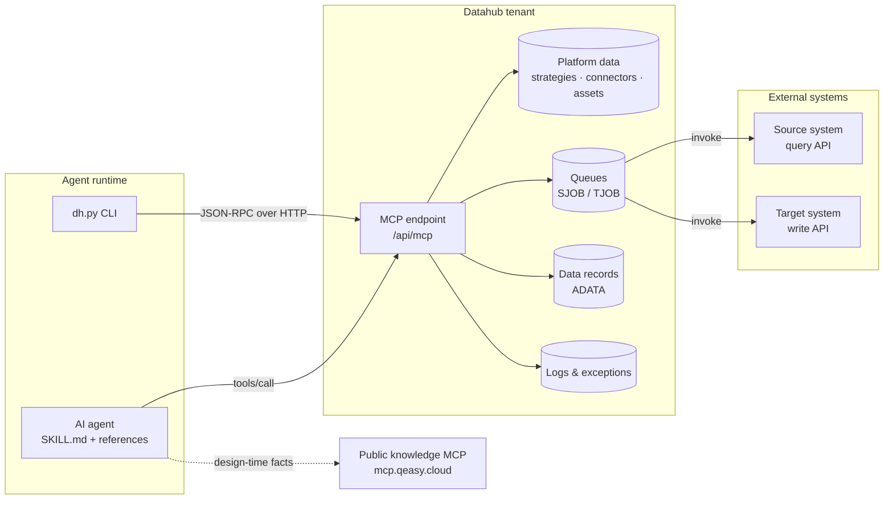
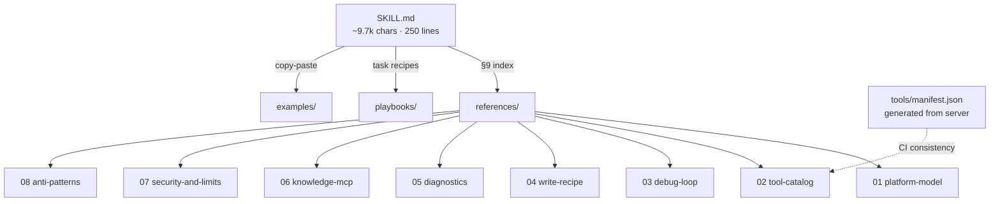
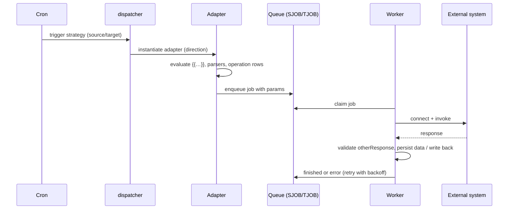
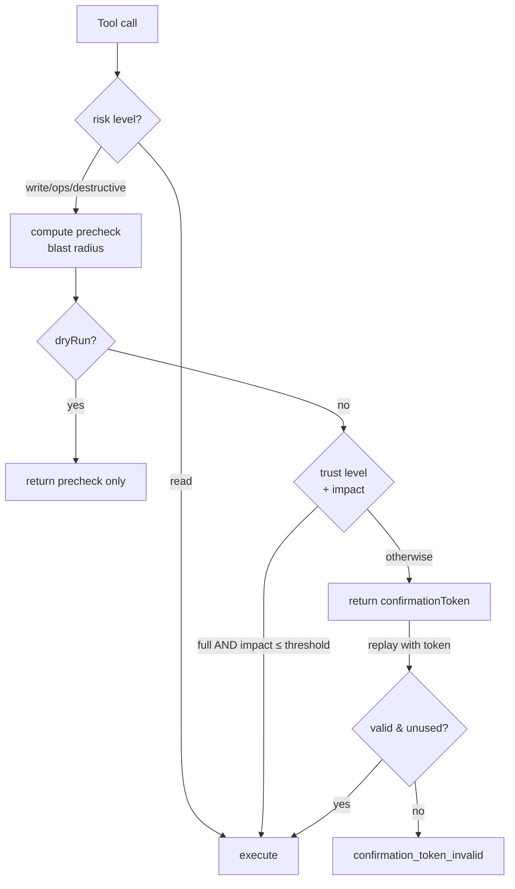
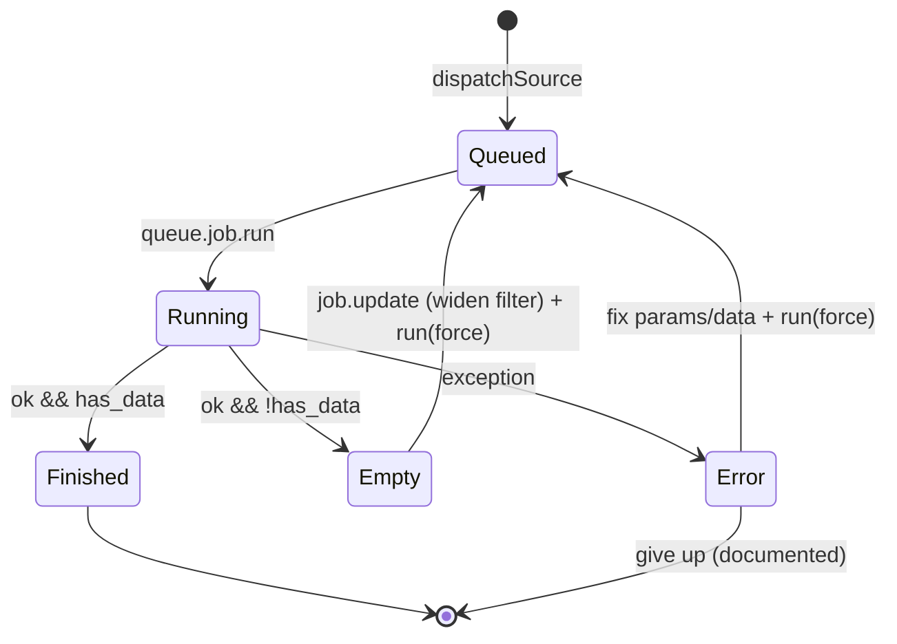

# Architecture

How this skill is put together, and how it maps onto the platform it operates.

---

## 1. System context

Two different MCP servers, deliberately separated:

| | Datahub MCP | Knowledge MCP |
|---|---|---|
| Purpose | read/write **your** tenant | read **documentation** |
| State | stateful (`Mcp-Session-Id`) | stateless (each request carries a key) |
| Auth | `sh-…` tenant key | `qk_live_…` agent-registrable key |
| Tools | 58 | 3 |

The skill uses the first to observe and act, the second only for facts a distilled document cannot hold
(object field lists, customer cases, cross-platform semantics).

---

## 2. Document layers (progressive disclosure)

Rules that keep this cheap:

1. **One topic per file.** Mechanism → `references/`, procedure → `playbooks/`, instance → `examples/`.
2. **The entry point is bounded.** Anything that grows past ~300 lines moves into a reference.
3. **Never duplicate.** A fact lives in exactly one file; the rest link to it.
4. **Manifest is generated, not written.** `scripts/dh.py manifest` reads the live server; CI fails when
   documentation mentions a tool the server does not expose.

---

## 3. Runtime chain on the platform

Where the skill intervenes when **no daemon exists**: instead of waiting for `W`, the agent calls
`strategy.queue.job.run`, which invokes the same adapter path synchronously and returns the outcome.

---

## 4. Tool layers and risk gates

```mermaid
flowchart LR
    subgraph read [🟢 read]
        r1[strategy.list/get/dbInfo]
        r2[queue.job.get · log.search]
        r3[asset.* · audit.search]
    end
    subgraph write [🟡 write]
        w1[source.update · target.update]
        w2[create · copy · data.import]
    end
    subgraph ops [🟠 ops]
        o1[dispatchSource/Target]
        o2[queue.job.run/update]
        o3[start · stop · online · offline]
        o4[data.setStatus · dbResetStatus]
    end
    subgraph destructive [🔴 destructive]
        d1[data.clean · queue.clean · data.cleanAll]
        d2[script.delete]
    end

    read --> write --> ops --> destructive
```

Gates applied before execution:

Independent hard gate: `strategy.queue.job.run {direction:"target"}` requires `confirmWrite=true`.
Trust level does **not** bypass it — an external ERP write cannot be rolled back by the platform.

---

## 5. Debug loop as a state machine

The skill's judgement rules map one-to-one onto these transitions:

| State | Field to read | Action |
|---|---|---|
| Queued | `status=5` | `queue.job.run` |
| Finished | `ok=true, has_data=true` | proceed to target side |
| Empty | `ok=true, has_data=false` | `log.search(level=debug)` → widen filter → `run(force=true)` |
| Error | `ok=false` + `exceptions` | `log.search(level=error,fatal)` + `exception.search` |
| Re-run needed | `skipped=already_finished` | `force=true` |

---

## 6. Why the CLI exists next to MCP

| Concern | MCP client | `dh.py` |
|---|---|---|
| Tool discovery | native | `tools` |
| Session / SSE handling | client's job | built-in |
| 429 backoff | client-dependent | implemented |
| Reproducible evidence in CI | hard | `--json` output |
| Manifest regeneration | manual | `manifest` |
| Shell quoting on Windows | n/a | `--param` |

Neither replaces the other: MCP gives native tool use inside an agent turn; the CLI gives determinism for
humans, scripts and CI.
